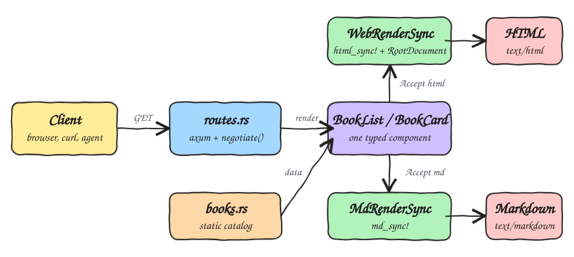
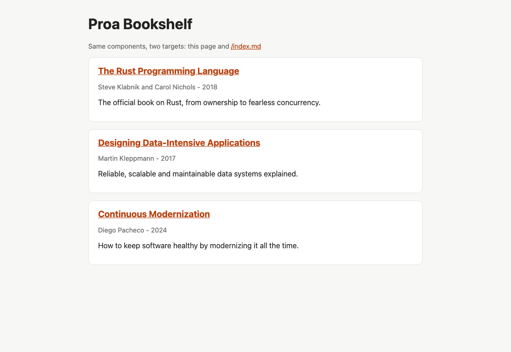
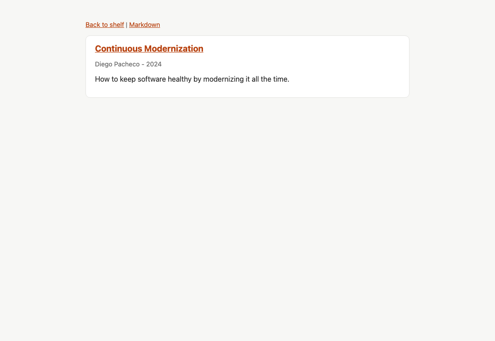
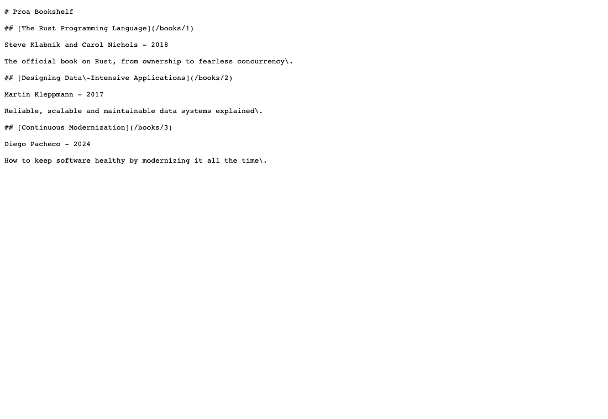

# proa-fun

A POC of [Proa](https://proa.so/), a Rust web framework where one typed component renders to more than one target.
This app is a small bookshelf: the same `BookList` and `BookCard` components produce an HTML page for browsers and a Markdown document for `curl`, scripts and LLM agents.

Rust 1.99.1, edition 2024.

## How it Works

1. `main.rs` binds a Tokio listener and hands the router to `proa_framework_axum::serve`, which adds graceful shutdown.
2. `routes.rs` builds the Axum router with `router_from_spec` and the Proa `RouteContextLayer`.
3. `books.rs` holds a static catalog of books.
4. `BookCard` and `BookList` implement both `WebRenderSync` (with `html_sync!`) and `MdRenderSync` (with `md_sync!`).
5. On `GET /`, `negotiate()` reads the `Accept` header: `text/markdown` gets Markdown, everything else gets HTML wrapped in `RootDocument`.
6. HTML responses carry a `Link: </index.md>; rel="alternate"` header pointing to the Markdown version.
7. `/index.md` and `/books/:id/md` always return Markdown, without negotiation.

## Architecture



## Features

* **Multi-target components**: one Rust struct, two render impls, so HTML and Markdown never drift apart.
* **Content negotiation**: `/` serves Markdown when the client asks for `text/markdown`, so agents get clean text instead of scraping HTML.
* **Explicit Markdown routes**: `/index.md` and `/books/:id/md` for clients that cannot set headers.
* **Typed templates**: `html_sync!` and `md_sync!` are checked at compile time and escape interpolated data for each target.
* **Server side rendering only**: no JavaScript is shipped to the browser.
* **Health endpoint**: `/healthz` for scripts and probes.

## Stack

* **Rust 1.99.1, edition 2024**: pinned with `rust-toolchain.toml` and `rust-version`.
* **proa_core**: render traits (`WebRenderSync`, `MdRenderSync`, `WebRender`) and `WebContext`.
* **proa_macros**: `html_sync!`, `html!` and `md_sync!` template macros.
* **proa_framework_axum**: `RouteResponse`, `negotiate`, `explicit_markdown`, `router_from_spec` and `serve`.
* **axum 0.7**: the HTTP router Proa is built on.
* **tokio**: async runtime.

No Proa CLI, Tailwind or database is needed. Plain CSS lives in `public/styles.css` and is embedded with `include_str!`.

## Contracts / APIs

| Method | Path | Response |
|---|---|---|
| GET | `/` | Book list as HTML, or Markdown with `Accept: text/markdown` |
| GET | `/index.md` | Book list as Markdown |
| GET | `/books/:id` | Book page as HTML, `404` for unknown ids |
| GET | `/books/:id/md` | Book as Markdown, `404` for unknown ids |
| GET | `/styles.css` | Stylesheet |
| GET | `/healthz` | `ok` |

```bash
curl http://localhost:3000/
curl -H 'Accept: text/markdown' http://localhost:3000/
curl http://localhost:3000/books/2/md
```

Markdown output of `/books/2/md`:

```markdown
## [Designing Data\-Intensive Applications](/books/2)

Martin Kleppmann - 2017

Reliable, scalable and maintainable data systems explained\.
```

## Key Data Structures and Design Decisions

* `Book` is a plain struct with `&'static str` fields and `BOOKS` is a `const` array, so components borrow data with no clones and no locks.
* `BookCard { book: &'static Book }` is the shared component. Both render impls use the same fields, so a field shown in one target is always available to the other.
* Sync render traits everywhere except `RootDocument`, which is async because `RouteResponse::ssr_async` needs a `WebRender` root. Sync components are lifted with `to_async`.
* `BookPage` exists only for HTML: navigation links have no meaning in Markdown, so the Markdown route renders `BookCard` directly.
* The Markdown list calls `md_block_boundary()` between cards so headings never glue to the previous paragraph.

## Source Layout

```
src/
  main.rs                 listener and serve
  routes.rs               router, handlers, negotiation
  books.rs                Book and BOOKS catalog
  layout.rs               RootDocument html shell
  components/
    book_card.rs          html + markdown
    book_list.rs          html + markdown
    book_page.rs          html only
  tests.rs                render tests
public/styles.css
scripts/                  ops scripts
```

## How to Run

```bash
./scripts/setup.sh
./scripts/start-all.sh
```

Or directly:

```bash
cargo run
```

Open http://localhost:3000. Set `PORT` to change the port when using `cargo run`.

## Tests

```bash
./scripts/test-all.sh
```

Runs the Rust render tests, then HTTP checks against the running app (it starts and stops the app when it is not already up).

* `one_card_renders_the_same_book_on_both_targets`: the HTML and Markdown of a card carry the same author, year and link.
* `markdown_target_has_no_html_markup`: agents never receive HTML tags in Markdown.
* `markdown_escapes_special_characters_from_data`: catalog text cannot break Markdown syntax.
* `html_escapes_markup_coming_from_data`: a hostile title is escaped, not executed.
* `list_shows_every_book_in_catalog_order_on_both_targets`: both targets list every book in the same order.
* `unknown_book_is_not_found`: unknown ids map to `404`.

```
test result: ok. 6 passed; 0 failed; 0 ignored; 0 measured; 0 filtered out
PASS html home
PASS markdown negotiation
PASS explicit markdown
PASS book page
PASS book markdown
PASS unknown book
all tests passed
```

## Printscreens

### Bookshelf (HTML)



`GET /` from a browser. `BookList` renders each `BookCard` through `WebRenderSync`, wrapped in `RootDocument`.

### Book page (HTML)



`GET /books/3`. `BookPage` adds navigation links around the same `BookCard` used on the shelf.

### Bookshelf (Markdown)



`GET /index.md`. The same components rendered through `MdRenderSync`: headings, links and escaped text, no HTML.

## Scripts

All scripts live in `scripts/` and run from any directory of the repository.

| Script | What it does |
|---|---|
| `./scripts/setup.sh` | Installs dependencies and prepares the app |
| `./scripts/start-all.sh` | Starts every service and prints the full link of each one |
| `./scripts/status.sh` | Shows every service port as UP or DOWN |
| `./scripts/test-all.sh` | Runs every test suite |
| `./scripts/ui.sh` | Opens the UI in the browser |
| `./scripts/stop-all.sh` | Stops every service |

Ports are declared in `scripts/ports.env` (`app=3000`).

```bash
./scripts/setup.sh
./scripts/start-all.sh
./scripts/status.sh
./scripts/ui.sh
./scripts/stop-all.sh
```
