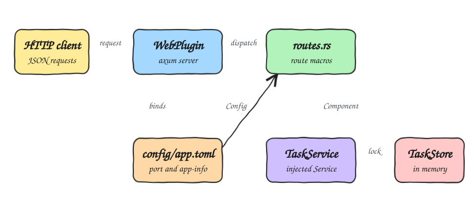

# summer-rs-fun

A proof of concept of [summer-rs](https://github.com/summer-rs/summer-rs), a Rust application
framework inspired by Spring Boot. It exposes a small REST API that manages tasks in memory, using
the framework's plugins, route macros, dependency injection and TOML configuration.

## How it Works?

1. `main` builds a summer-rs `App` and adds the `WebPlugin`, which starts an axum server.
2. `#[auto_config(WebConfigurator)]` collects every handler marked with `#[get]`, `#[post]`,
   `#[put]` or `#[delete]` and registers it, so there is no manual router.
3. `config/app.toml` sets the web port and the `app-info` section.
4. `TaskService` derives `Service`, so summer-rs builds it once and registers it as a component.
5. Handlers receive the service with the `Component` extractor and the settings with the `Config`
   extractor.
6. Tasks live in a `TaskStore` behind an `Arc<Mutex<_>>`, shared by every request.

## Architecture



## Features

* **Task CRUD**: create, list, read, complete and delete tasks over JSON.
* **Auto registered routes**: handlers are discovered by macro, nothing to wire by hand.
* **Injected service**: `TaskService` is created by the framework and handed to each handler.
* **Typed configuration**: the `app-info` section of the TOML file is read into a struct.
* **HTTP errors**: missing tasks return `404` and blank titles return `400`.

## Stack

* **Rust 2024**: the language of the project.
* **summer**: application container, plugins, configuration and dependency injection.
* **summer-web**: axum integration with route macros and extractors.
* **tokio**: async runtime required by summer-rs.
* **serde**: JSON bodies and configuration structs.

## Contracts/APIs

The server listens on `http://localhost:8080`.

| Method | Path | Body | Success | Errors |
|---|---|---|---|---|
| `GET` | `/` | | `200` greeting text from the configuration | |
| `GET` | `/health` | | `200` `UP` | |
| `GET` | `/tasks` | | `200` list of tasks | |
| `GET` | `/tasks/{id}` | | `200` task | `404` unknown id |
| `POST` | `/tasks` | `{"title": "..."}` | `201` created task | `400` blank title |
| `PUT` | `/tasks/{id}/done` | | `200` completed task | `404` unknown id |
| `DELETE` | `/tasks/{id}` | | `204` | `404` unknown id |

A task looks like this:

```json
{"id": 1, "title": "learn summer-rs", "done": false}
```

```bash
curl -X POST http://localhost:8080/tasks -H 'content-type: application/json' -d '{"title":"learn summer-rs"}'
curl http://localhost:8080/tasks
curl -X PUT http://localhost:8080/tasks/1/done
curl -X DELETE http://localhost:8080/tasks/1
```

## Key data structures and design decisions

* `Task`: `id`, `title` and `done`.
* `TaskStore`: a `Vec<Task>` plus the last id handed out, so an id is never reused after a delete.
* `TaskService`: holds `Arc<Mutex<TaskStore>>`. summer-rs clones the service per request and every
  clone points to the same store.
* Storage is in memory on purpose to keep the project free of extra plugins. Data is lost on restart.
* Service methods return `Option` or `bool` and the handlers translate them into HTTP status codes,
  which keeps the service free of web types and easy to unit test.

## How to run the app/tests

```bash
./scripts/setup.sh
./scripts/start-all.sh
./scripts/test-all.sh
./scripts/stop-all.sh
```

## Scripts

All scripts live in `scripts/` and run from any directory of the repository.

| Script | What it does |
|---|---|
| `./scripts/setup.sh` | Builds the app and its dependencies |
| `./scripts/start-all.sh` | Starts the backend and prints its full link |
| `./scripts/status.sh` | Shows the backend port as UP or DOWN |
| `./scripts/test-all.sh` | Runs every test suite |
| `./scripts/stop-all.sh` | Stops the backend |

Ports are declared in `scripts/ports.env`.

```bash
./scripts/setup.sh
./scripts/start-all.sh
./scripts/status.sh
./scripts/stop-all.sh
```
